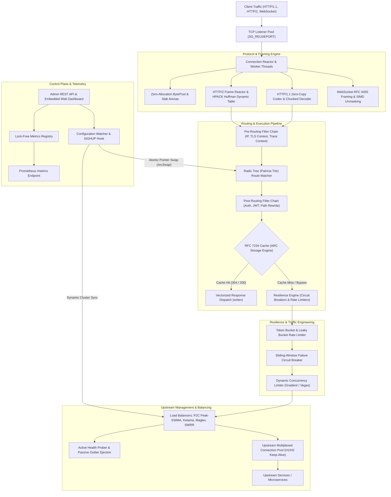

# Torque

```
  _______ ____  _____   ____  _    _ ______ 
 |__   __/ __ \|  __ \ / __ \| |  | |  ____|
    | | | |  | | |__) | |  | | |  | | |__   
    | | | |  | |  _  /| |  | | |  | |  __|  
    | | | |__| | | \ \| |__| | |__| | |____ 
    |_|  \____/|_|  \_\\___\_\\____/|______|
```

**Torque** is a high-throughput, asynchronous, zero-allocation Layer-7 programmable reverse proxy, edge traffic router, and service mesh data plane engineered in pure Rust.

Designed for microsecond-sensitive edge routing, API gateway orchestration, and resilient service-to-service communication, Torque combines a zero-copy protocol reactor with radix-tree route matching, adaptive load balancing, hardware-conscious buffer pools, and zero-downtime configuration hot-reloading.

---

## Technical Highlights

* **Zero-Allocation Buffer Pools**: Cache-line aligned, slab-based chunk allocators (`BytePool` and `SegmentedBuf`) recycling pre-allocated memory arenas to eliminate heap churn on high-throughput network paths.
* **Lock-Free Multi-Producer Ring Buffers**: Atomic sequence-based ring buffers operating without mutex contention, providing low-latency event propagation across worker threads.
* **Full-Featured Protocol Engines**:
  * **HTTP/1.1**: Zero-copy request and response parser, chunked transfer encoding codec, pipelining support, and vectored `writev` response dispatch.
  * **HTTP/2 (RFC 7540)**: Complete framing pipeline, stream state transition machine, connection-level and stream-level flow control accounting, priority trees, and HPACK header compression with canonical Huffman coding (RFC 7541).
  * **WebSocket (RFC 6455)**: Bidirectional streaming upgrade, streaming frame decoding, and SIMD/XOR masking vectorization.
* **Dynamic Radix Patricia Trie Router**: Prefix-tree path resolution supporting parameterized routes (`:id`), wildcards (`*path`), regex parameter constraints, and multi-attribute route predicates (HTTP methods, headers, query strings, host SNI).
* **Adaptive Load Balancing**:
  * **Smooth Weighted Round Robin (SWRR)**: Smoothly interleaves requests across variable capacity upstreams without burst clustering.
  * **Peak-EWMA (Power of Two Random Choices)**: Dynamically steers traffic toward endpoints minimizing active in-flight requests and exponential moving average latency.
  * **Ketama and Maglev Consistent Hashing**: Virtual node ring distribution and Google Maglev lookup tables ensuring deterministic routing with bounded disruption during node churn.
  * **Biased Least Outstanding Requests**: Routes to nodes with the lowest active connection load.
* **Multi-Tier Resilience Engine**:
  * **4-State Circuit Breaker**: Time-bucketed circular sliding window tracking failure ratios and slow calls with concurrency-bounded half-open trial probes.
  * **Nanosecond Token and Leaky Bucket Rate Limiters**: High-precision token generation, multi-attribute quota tiers, and lightweight UDP/TCP gossip state synchronization.
  * **Retry Budgeting**: Jittered exponential backoff with token-based retry budgets preventing cascading retry storms.
  * **Dynamic Concurrency Control**: Gradient and Vegas algorithms dynamically shedding excess load under system strain.
* **RFC 7234 Compliant HTTP Caching**: Adaptive Replacement Cache (ARC) self-tuning memory engine balancing recency and frequency, with automated `304 Not Modified` conditional response generation.
* **Pluggable Filter Pipeline**: Pre-routing, post-routing, and upstream lifecycle filters supporting JWT validation (HMAC/RSA), API keys, CORS preflight, OpenTelemetry W3C `traceparent` propagation, and response compression (Gzip, Deflate, Brotli).
* **Atomic Zero-Downtime Hot-Reloading**: Real-time configuration updates via file watchers or administrative REST calls swapped via atomic pointers (`ArcSwap`) without dropping active TCP connections or interrupting in-flight streams.
* **Lock-Free Telemetry and Embedded Web Console**: High-resolution HDR latency histograms, Prometheus metrics export (`/metrics`), structured JSON access logs, and an embedded single-page reactive dashboard.

---

## Architectural Topography



---

## Quick Start

### Prerequisites
- Rust 1.75+ or newer
- Cargo build toolchain
- Python 3.10+ (for test suite and SDK tools)

### Building from Source

```bash
# Clone the repository
git clone https://github.com/Aneesh495/torque.git
cd torque

# Build the complete workspace
cargo build --workspace --release

# Run unit and integration tests
cargo test --workspace
```

### Running the Gateway

```bash
# Start Torque with the sample configuration
cargo run --bin torque-cli -- start --config examples/gateway.yaml
```

The gateway listens on:
- **Proxy Port**: `http://127.0.0.1:8080` (Client ingress traffic)
- **Admin & Metrics Port**: `http://127.0.0.1:9090` (Admin API, `/metrics`, and `/dashboard`)

---

## Configuration Reference

Torque uses a declarative YAML/JSON/TOML configuration schema:

```yaml
server:
  bind_addr: "0.0.0.0:8080"
  worker_threads: 8
  max_connections: 50000
  tcp_nodelay: true
  buffer_size_kb: 64

admin:
  bind_addr: "127.0.0.1:9090"
  enable_dashboard: true

clusters:
  - name: "api_service"
    lb_policy: "peak_ewma"
    endpoints:
      - addr: "10.0.1.10:8000"
        weight: 10
      - addr: "10.0.1.11:8000"
        weight: 10
    health_check:
      path: "/healthz"
      interval_ms: 2000
      timeout_ms: 500
      healthy_threshold: 2
      unhealthy_threshold: 3
    circuit_breaker:
      failure_rate_threshold: 0.5
      sliding_window_size: 100
      half_open_probes: 5
      recovery_time_ms: 5000

routes:
  - name: "user_api"
    path: "/api/v1/users/:id"
    methods: ["GET", "POST"]
    cluster: "api_service"
    rate_limit:
      rate: 1000
      burst: 200
      key_type: "ip"
    cache:
      enabled: true
      ttl_seconds: 60
    plugins:
      - name: "jwt_auth"
        secret: "secret-key"
      - name: "security_headers"
      - name: "traceparent"
```

---

## Monograph Index

Detailed engineering monographs and specifications are available in the [`docs/`](docs/) directory:

- [Architecture Overview](docs/architecture.md)
- [Protocol Engine Specification](docs/protocol_engine.md)
- [Load Balancing and Health Probing](docs/load_balancing.md)
- [Resilience and Rate Limiting](docs/resilience.md)
- [RFC 7234 Caching Engine](docs/caching.md)
- [Performance and Benchmarks](docs/benchmarks.md)

---

## License

Dual-licensed under either Apache License, Version 2.0 or MIT license at your option.
