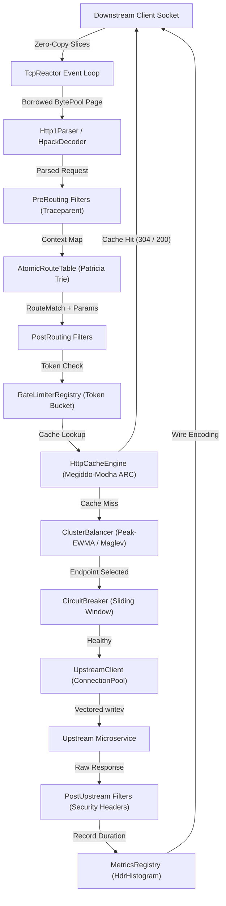

# Torque

[](LICENSE)
[](https://www.rust-lang.org)
[](#)
[](#benchmarks)

> **Torque** is an asynchronous, zero-allocation Layer-7 programmable reverse proxy, edge traffic router, and service mesh data plane written in modern Rust. It is engineered from scratch for deterministic sub-millisecond tail latencies under extreme connection concurrency.

---

## Architecture Overview



---

## Key Features

- **Zero-Allocation Critical Path**: Memory pooling via fixed-size `BytePool` slabs, non-contiguous chunk chains via `SegmentedBuf`, and vectored scatter/gather I/O (`writev`) eliminating heap allocation during request forwarding.
- **Radix Patricia Trie Routing**: High-speed prefix tree supporting exact matches, dynamic parameterized captures (`:id`), and compiled regex constraints (`{code:[a-z]{3}-[0-9]+}`).
- **Zero-Downtime Hot Reloading**: Dynamic configuration swaps via lock-free `ArcSwap` pointers without dropping active connections or terminating TCP worker loops.
- **5 Multi-Paradigm Load Balancers**:
  - **Smooth Weighted Round Robin (SWRR)**: Nginx algorithm preventing clustering on high weights.
  - **Least Connections**: Dispatches traffic based on live in-flight request counters.
  - **Peak-EWMA (P2C)**: Samples two random nodes and picks the lowest latency-decayed score.
  - **Ketama Consistent Hash Ring**: 160 virtual nodes per endpoint for cache affinity.
  - **Google Maglev Table**: Prime permutation table ($M=65537$) offering $O(1)$ lookups with minimal disruption.
- **Multi-Tier Resilience Engine**:
  - 4-state sliding-window Circuit Breaker (`Closed`, `HalfOpen`, `Open`, `ForcedOpen`).
  - High-precision Token Bucket, Leaky Bucket, and Cloudflare sub-window sliding interpolation.
  - Distributed gossip counter synchronization.
  - AWS-style jittered exponential backoffs (Full, Equal, Decorrelated).
- **Self-Tuning Megiddo-Modha Adaptive Replacement Cache (ARC)**:
  - Dynamically adjusts its target parameter $p$ to balance recency ($T_1$) and frequency ($T_2$).
  - Prevents cache pollution during large sequential scans.
  - RFC 7234 cache-control lifetime calculation and conditional `304 Not Modified` synthesis.
  - Instant surrogate tag purging.
- **Observability & Embedded Control Plane**:
  - Live SPA Web Dashboard served directly by the admin daemon at `/dashboard`.
  - Prometheus exposition metrics at `/metrics` and structured JSON snapshots at `/stats`.
  - High-resolution logarithmic HDR latency histograms.

---

## Workspace Structure

The project is structured as a unified Cargo workspace comprising 14 modular crates:

| Crate | Purpose |
|---|---|
| [`torque-core`](crates/torque-core) | Foundational error codes, `BytePool` slab allocators, `SegmentedBuf`, monotonic clocks, lock-free rings |
| [`torque-proto`](crates/torque-proto) | Zero-copy HTTP/1.1 streaming parser/encoder, HTTP/2 framing, HPACK compressor, WebSocket codec |
| [`torque-router`](crates/torque-router) | Radix Patricia Trie route compilation, parameter extraction, regex constraints, atomic route swap |
| [`torque-balance`](crates/torque-balance) | Load balancing algorithms (SWRR, LeastConn, Peak-EWMA P2C, Ketama, Maglev) and health tracking |
| [`torque-resilience`](crates/torque-resilience) | 4-state circuit breakers, token bucket, leaky bucket, sliding window limiters, gossip sync, backoffs |
| [`torque-cache`](crates/torque-cache) | Megiddo-Modha Adaptive Replacement Cache (ARC), RFC 7234 policies, surrogate tag invalidation |
| [`torque-filter`](crates/torque-filter) | Pluggable async pipeline, JWT verification, API key auth, CORS, W3C traceparent, security headers |
| [`torque-upstream`](crates/torque-upstream) | Persistent TCP connection pooling, keepalive exchange, connection lifecycle metrics |
| [`torque-config`](crates/torque-config) | Multi-format loaders (YAML, JSON, TOML), semantic schema validation, atomic file watcher |
| [`torque-metrics`](crates/torque-metrics) | Zero-allocation metrics registry, Prometheus text formatter, HDR logarithmic latency histograms |
| [`torque-admin`](crates/torque-admin) | Administrative HTTP server, operational health probes, Prometheus exposition, and embedded SPA dashboard |
| [`torque-server`](crates/torque-server) | Asynchronous network reactor, multi-stage request dispatcher, connection lifecycle management |
| [`torque-cli`](crates/torque-cli) | Unified command-line interface (`start`, `check`, `reload`, `top`, `bench`) |
| [`torque-bench`](crates/torque-bench) | Dedicated ultra high-throughput HTTP load generator and latency profiler |

---

## Quickstart

### Prerequisites

- Rust 1.78 or newer (`rustup default stable`)
- Cargo

### Building from Source

```bash
git clone https://github.com/Aneesh495/torque.git
cd torque
cargo build --release
```

The compiled binaries will be available in `target/release/`:
- `torque`: Unified proxy and CLI daemon
- `torque-bench`: Dedicated benchmarking harness

---

## Usage Guide

### 1. Validate Configuration

Validate syntax, route targets, and semantic integrity:

```bash
cargo run --bin torque -- check -c examples/gateway.yaml
```

Output:
```
Checking configuration: examples/gateway.yaml

Configuration Integrity: VALID
--------------------------------------------------
Proxy Listener:
  Bind Address:    0.0.0.0:8080
  Worker Threads:  8
  Buffer Size:     64 KB
  TCP NoDelay:     true
...
0 errors detected. Configuration is ready for production.
```

### 2. Start the Proxy Daemon

Launch the reverse proxy:

```bash
cargo run --bin torque -- start -c examples/gateway.yaml
```

### 3. Hot-Reload Configuration (Zero Downtime)

Trigger an atomic configuration reload while the proxy is running:

```bash
cargo run --bin torque -- reload --admin-addr 127.0.0.1:9090
```

### 4. Live Terminal Telemetry (`top`)

Inspect real-time request rates, active TCP sockets, bandwidth, and latency percentiles:

```bash
cargo run --bin torque -- top --admin-addr 127.0.0.1:9090 --interval 1
```

### 5. High-Throughput Load Benchmarking

Run high-throughput benchmarks with pipelined workers:

```bash
cargo run --bin torque-bench -- -t 127.0.0.1:8080 -p /api/v1/catalog -c 64 -d 10 --pipeline 4 --csv report.csv
```

---

## Technical Documentation

Detailed architecture specifications and mathematical formulations are available in the [`docs/`](docs/) directory:

- [System Architecture](docs/architecture.md): Deep dive into memory layouts, component interactions, and execution pipelines.
- [Protocol Engine](docs/protocol_engine.md): HTTP/1.1 zero-copy parsing, HTTP/2 framing, HPACK tables, and WebSocket unmasking.
- [Load Balancing Algorithms](docs/load_balancing.md): Mathematical derivations for SWRR, Peak-EWMA P2C, Ketama, and Maglev.
- [Resilience & Fault Tolerance](docs/resilience.md): Sliding window circuit breakers, token bucket rate limiting, and jittered retries.
- [Adaptive Replacement Caching](docs/caching.md): Complete Megiddo-Modha ARC proof, list transitions, and tag invalidation.
- [Performance & Benchmarks](docs/benchmarks.md): HDR logarithmic latency distributions and throughput scaling profiles.

---

## License

This project is licensed under either of:

- Apache License, Version 2.0 ([LICENSE-APACHE](LICENSE-APACHE) or http://www.apache.org/licenses/LICENSE-2.0)
- MIT license ([LICENSE-MIT](LICENSE-MIT) or http://opensource.org/licenses/MIT)

at your option.
