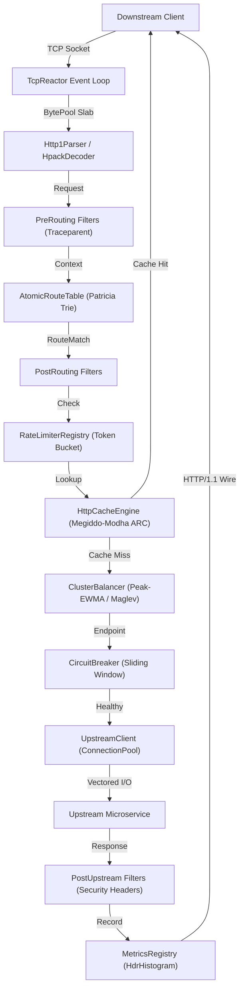
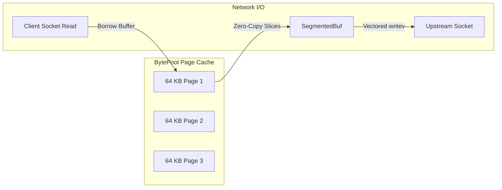
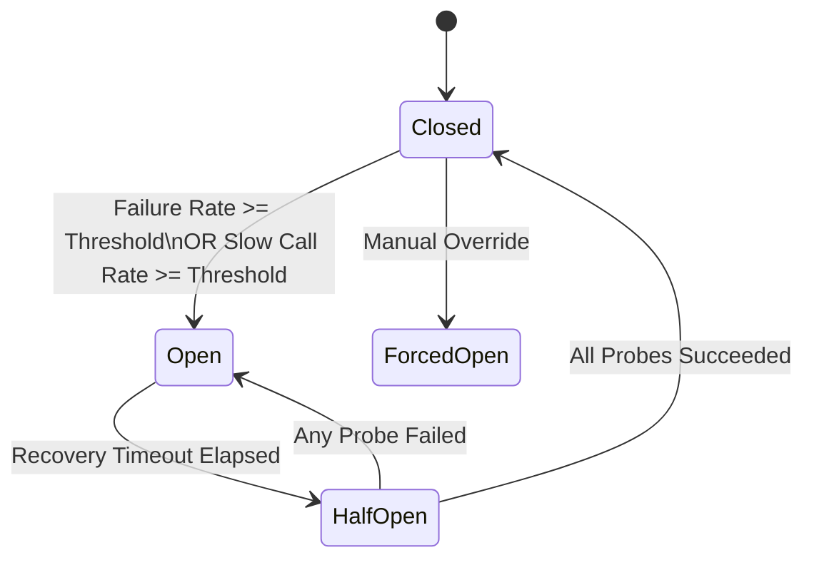
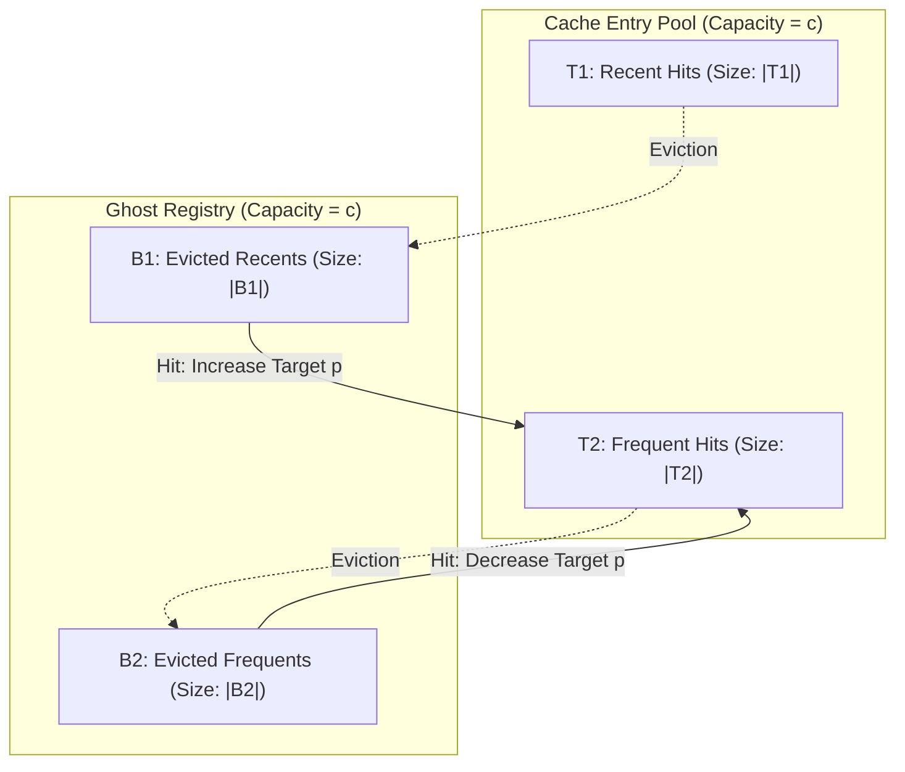

# Torque Architecture Specification

## 1. Executive Summary

Torque is an asynchronous, zero-allocation Layer-7 programmable reverse proxy, edge traffic router, and service mesh data plane engineered in Rust. It delivers predictable sub-millisecond tail latencies under extreme connection concurrency while providing rich operational capabilities: Radix Patricia Trie routing with regex constraints, five distinct load balancing algorithms, 4-state sliding-window circuit breaking, multi-tier rate limiting, and a Megiddo-Modha Adaptive Replacement Cache (ARC).

---

## 2. Zero-Copy Vectored Memory Model

Modern high-performance proxies spend an overwhelming majority of their CPU cycles on heap allocation, buffer resizing, and memory copying between kernel and user space. Torque eliminates dynamic allocations along the critical path through three coordinated memory structures:

1. **`BytePool`**: A thread-safe, lock-free slab allocator providing fixed-size page blocks (default 64 KB). Sockets borrow buffers wrapped in RAII `PooledBuf` handles that automatically return memory to the slab upon destruction.
2. **`SegmentedBuf`**: A non-contiguous chunk chain representing streaming HTTP bodies and framing without copying. Chunks are held as an array of `Bytes` slices.
3. **Vectored I/O (`IoSlice`)**: Downstream response encoding uses vectored scatter/gather system calls (`writev`), writing headers, chunk delimiters, and body buffers directly from non-contiguous pages in a single kernel transition.

---

## 3. Radix Patricia Trie Routing

Request routing in Torque uses an optimized Radix Patricia Trie (`TrieNode<T>`) supporting prefix compression, dynamic parameterized captures (`/api/v1/users/:id`), and compiled regular expression segment constraints (`/items/{code:[a-z]{3}-[0-9]+}`).

Route evaluation operates in deterministic time:
- Exact path segments evaluate via prefix slice comparison.
- Parameterized nodes extract captures directly into a stack-allocated `RouteParams` map without string allocation.
- Regex-constrained segments evaluate before wildcard segments, guaranteeing deterministic rule precedence.
- Atomic route swapping via `AtomicRouteTable` uses `ArcSwap` to replace the compiled trie in $O(1)$ time with zero reader locking.

---

## 4. Multi-Algorithm Load Balancing

Upstream endpoint selection is decoupled behind the `ClusterBalancer` interface, implementing five specialized balancing strategies:

| Algorithm | Complexity | Selection Strategy | Optimal Use Case |
|---|---|---|---|
| **Smooth Weighted Round Robin (SWRR)** | $O(N)$ | Nginx dynamic current-weight algorithm with smooth spreading | General heterogeneous upstream clusters |
| **Least Connections** | $O(N)$ | Minimum active in-flight request counter | Long-lived RPC and streaming workloads |
| **Peak-EWMA P2C** | $O(1)$ | Latency-decayed Power of Two Choices | Tail-latency minimization in high-throughput clusters |
| **Ketama Consistent Hash** | $O(\log V)$ | 160 virtual nodes per server on MD5 continuum | Cache-affinity routing and stateful gateways |
| **Maglev Table** | $O(1)$ | Prime lookup table ($M=65537$) with pseudo-random permutations | Equal distribution with minimal disruption on churn |

### Peak-EWMA Formulation

For each endpoint $i$, Torque maintains an exponentially weighted moving average (EWMA) of round-trip latency $\tau_i$:

$$\text{EWMA}_{t} = \alpha \cdot \text{RTT}_t + (1 - \alpha) \cdot \text{EWMA}_{t-1}$$

The selection score balances historical latency against active load:

$$\text{Score}_i = \text{EWMA}_i \times (\text{ActiveConnections}_i + 1)$$

Two random endpoints $a$ and $b$ are sampled ($P2C$), and the endpoint with $\min(\text{Score}_a, \text{Score}_b)$ is selected in $O(1)$ time.

---

## 5. Multi-Tier Resilience Engine

Torque guards against cascading failure through an integrated resilience pipeline:

### Resilience Components

1. **4-State Circuit Breaker (`CircuitBreaker`)**:
   - `Closed`: Normal traffic flow. Metrics recorded in a 100ms time-bucketed sliding window.
   - `Open`: Upstream rejected immediately with 503 Service Unavailable and `X-Torque-Circuit: OPEN`.
   - `HalfOpen`: Limited trial probe requests dispatched to verify upstream recovery.
   - `ForcedOpen`: Administrative operational isolation.
2. **Rate Limiting Subsystem**:
   - High-precision `TokenBucket` for bursty traffic.
   - `LeakyBucket` for smooth egress rate shaping.
   - `SlidingWindowLimiter` with Cloudflare weighted sub-window estimation.
   - Distributed gossip synchronization (`GossipAggregator`) exchanging counter vectors.
3. **Jittered Exponential Backoff**:
   - Full Jitter: $t = \text{rand}(0, \min(C, B \cdot 2^A))$
   - Equal Jitter: $t = \frac{T}{2} + \text{rand}(0, \frac{T}{2})$
   - Decorrelated Jitter: $t = \min(C, \text{rand}(B, P \cdot 3))$

---

## 6. Self-Tuning Adaptive Replacement Cache (ARC)

To provide maximum cache efficiency without manual tuning, Torque implements the Megiddo-Modha Adaptive Replacement Cache (USENIX FAST 2003):

The adaptation parameter $p \in [0, c]$ dynamically expands $T_1$ when recency dominates, or contracts $T_1$ to favor $T_2$ when frequency dominates:

$$\Delta p_1 = \max\left(1, \frac{|B_2|}{|B_1|}\right) \quad \text{when hit in } B_1$$
$$\Delta p_2 = \max\left(1, \frac{|B_1|}{|B_2|}\right) \quad \text{when hit in } B_2$$

Additionally, Torque supports RFC 7234 cache lifetime derivation, ETag conditional matching (`304 Not Modified` synthesis), and surrogate tag invalidation in $O(1)$ time.

---

## 7. Administrative Control Plane & Telemetry

Torque exposes an integrated administrative HTTP daemon supporting:
- `/healthz` and `/live`: Liveness probes.
- `/ready`: Readiness probes.
- `/metrics`: Full Prometheus exposition format.
- `/stats`: Real-time JSON telemetry snapshot.
- `/config`: Active declarative configuration snapshot.
- `/config/reload`: Hot-reload trigger.
- `/dashboard`: Self-contained Single-Page Application (SPA) dashboard.
