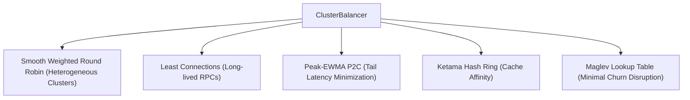

# Torque Load Balancing Algorithms

## 1. Overview

Torque decouples upstream load balancing into discrete, modular algorithmic implementations managed under the `ClusterBalancer` facade. It provides five specialized algorithms matching diverse workload profiles:

---

## 2. Smooth Weighted Round Robin (SWRR)

Standard weighted round-robin algorithms exhibit clustering tendencies, sending bursts of requests consecutively to the highest-weighted server. Torque implements Nginx's Smooth Weighted Round Robin algorithm, which distributes traffic uniformly across time:

### Algorithm Formulation

Let $S = \{e_1, e_2, \dots, e_n\}$ be the set of endpoints with configured weights $W = \{w_1, w_2, \dots, w_n\}$ and total weight $W_{\text{total}} = \sum_{i=1}^n w_i$.

Each endpoint tracks a stateful `current_weight`, initialized to 0. On each selection round:

1. For each endpoint $i$:
   $$\text{current\_weight}_i \leftarrow \text{current\_weight}_i + w_i$$
2. Select endpoint $k$ such that:
   $$k = \arg\max_{i} \text{current\_weight}_i$$
3. Deduct total weight from the chosen endpoint:
   $$\text{current\_weight}_k \leftarrow \text{current\_weight}_k - W_{\text{total}}$$
4. Return endpoint $k$.

This guarantees that over any sequence of $W_{\text{total}}$ requests, each server $i$ receives exactly $w_i$ requests without consecutive clustering.

---

## 3. Peak-EWMA with Power of Two Choices (P2C)

To minimize tail latencies ($p99$ and $p99.9$) in large microservice clusters, Torque couples Exponentially Weighted Moving Average (EWMA) latency estimation with Michael Mitzenmacher's Power of Two Choices (P2C) principle:

### Mathematical Properties

1. **Latency Smoothing**:
   $$\text{EWMA}_{t} = \alpha \cdot \text{RTT}_t + (1 - \alpha) \cdot \text{EWMA}_{t-1}$$
   where $\alpha = 1 - e^{-\Delta t / \tau}$, with decay constant $\tau = 10\text{ seconds}$.

2. **Load Score Calculation**:
   $$\text{Score}_i = \text{EWMA}_i \times (\text{ActiveRequests}_i + 1)$$

3. **$O(1)$ Selection**:
   Instead of searching all $N$ nodes in $O(N)$, Torque samples two independent candidate endpoints $a, b \in S$ at random and selects:
   $$e^* = \begin{cases} a & \text{if } \text{Score}_a \le \text{Score}_b \\ b & \text{otherwise} \end{cases}$$

This approach yields exponential queue reduction from $O(\log N / \log \log N)$ to $O(\log \log N)$ while maintaining $O(1)$ algorithmic complexity.

---

## 4. Ketama Consistent Hash Ring

For distributed caches and stateful upstream services, Torque implements a Ketama consistent hash ring:

- Each physical endpoint is replicated across 160 virtual nodes (vnodes) generated via MD5 digests:
  $$\text{Hash}(e_i \mathbin{\Vert} \text{"-vnode-"} \mathbin{\Vert} j) \quad \text{for } j \in [0, 159]$$
- Virtual nodes are sorted along a 32-bit integer continuum ring: $[0, 2^{32}-1]$.
- Incoming routing keys (e.g. User ID, Session Token, Client IP) are hashed to a point $H_k$ on the ring.
- Binary search (`partition_point`) locates the first virtual node with ring position $\ge H_k$ in $O(\log V)$ time.
- Adding or removing an endpoint shifts at most $1/N$ of keys, preventing massive cache stampedes.

---

## 5. Google Maglev Consistent Hash Table

For high-throughput edge routers requiring constant-time lookup and near-zero disruption during server churn, Torque implements Google's Maglev algorithm:

### Table Construction

A lookup table of prime size $M = 65537$ is generated. For each endpoint $i$:
1. Compute two independent hashes:
   $$h_1 = \text{Murmur3}(e_i), \quad h_2 = \text{CityHash}(e_i)$$
2. Define a pseudo-random permutation sequence across $[0, M-1]$:
   $$\text{offset} = h_1 \pmod M, \quad \text{skip} = (h_2 \pmod{(M - 1)}) + 1$$
   $$\text{perm}(j) = (\text{offset} + j \times \text{skip}) \pmod M$$
3. Populate the lookup table by round-robin iteration over candidate endpoints until all $M$ slots are filled.
4. Lookup runs in $O(1)$ time: $\text{Table}[\text{Hash}(k) \pmod M]$.
