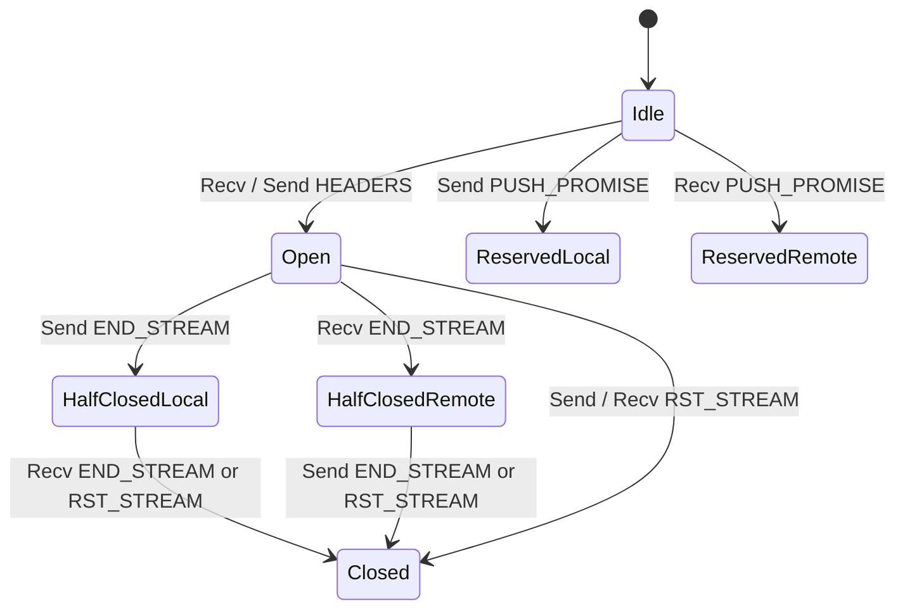

# Torque Protocol Engine Specification

## 1. Zero-Copy HTTP/1.1 Streaming Reactor

Torque implements an RFC 7230 conformant streaming parser and encoder optimized for zero heap allocations on the critical message processing path.

### 1.1 Parsing State Machine

The parser operates incrementally over raw byte buffers using a non-backtracking scanner:

1. **Request Line**:
   - Locates method token via byte slice comparison (`GET`, `POST`, `PUT`, `DELETE`, `PATCH`, `HEAD`, `OPTIONS`).
   - Slices request URI without allocation.
   - Validates HTTP version token (`HTTP/1.1` or `HTTP/1.0`).
2. **Header Parsing**:
   - Scans CRLF delimited headers into a specialized `HeaderMap` backed by contiguous index spans.
   - Header field names and values are sliced directly from the socket buffer.
   - Case-insensitive header lookup uses ASCII bit masking: `b | 0x20`.
3. **Framing & Payload Extraction**:
   - `Content-Length`: Extracts fixed-size payload into zero-copy `Bytes` slices.
   - `Transfer-Encoding: chunked`: Parses RFC 7230 chunk hex sizes, strips trailing CRLF, and reassembles fragmented chunks into non-contiguous `SegmentedBuf` chunks.

```
+--------------------------------------------------------+
| REQUEST LINE: METHOD [space] URI [space] VERSION \r\n |
+--------------------------------------------------------+
| HEADERS: Name: Value \r\n                              |
|          Name: Value \r\n                              |
+--------------------------------------------------------+
| CRLF BOUNDARY: \r\n                                    |
+--------------------------------------------------------+
| BODY / CHUNKS: Zero-Copy PooledBuf Slice               |
+--------------------------------------------------------+
```

---

## 2. HTTP/2 RFC 7540 Reactor & Frame Codec

Torque incorporates an RFC 7540 framing and stream multiplexing engine.

### 2.1 9-Byte Frame Header Format

Every HTTP/2 frame begins with a fixed 9-byte header decoded directly via big-endian integer reading:

```
+-----------------------------------------------+
|                 Length (24)                   |
+---------------+---------------+---------------+
|   Type (8)    |   Flags (8)   |
+-+-------------+---------------+-------------------------------+
|R|                 Stream Identifier (31)                      |
+=+=============================================================+
|                   Frame Payload (0...)                      ...
+---------------------------------------------------------------+
```

The codec supports all standard RFC 7540 frame types:
- `DATA (0x0)`: Multiplexed payload chunks with padding support.
- `HEADERS (0x1)`: HPACK compressed header blocks and stream priority weights.
- `PRIORITY (0x2)`: Stream dependency tree management.
- `RST_STREAM (0x3)`: Immediate stream termination.
- `SETTINGS (0x4)`: Connection configuration parameters.
- `PING (0x6)`: Connection round-trip latency probe.
- `GOAWAY (0x7)`: Graceful connection shutdown.
- `WINDOW_UPDATE (0x8)`: Flow control credit replenishment.

### 2.2 7-State Stream Lifecycle

Each multiplexed stream transitions through the canonical RFC 7540 state machine:



---

## 3. RFC 7541 HPACK Compression Engine

HTTP/2 header compression achieves high density through HPACK:

1. **Static Table**: Pre-defined 61 canonical header name/value pairs.
2. **Dynamic Table**: FIFO table with byte-bounded capacity eviction. When table size exceeds maximum capacity, oldest entries are evicted in $O(1)$ time.
3. **Canonical Huffman Decoder**: 256-symbol static Huffman code table derived from character frequencies in production HTTP traffic.
   - Symbols are decoded using a fast multi-bit state lookup.
   - Bit accumulation handles unaligned byte streams with zero allocation.

---

## 4. RFC 6455 WebSocket Framing & Protocol Upgrade

Torque handles WebSocket connection upgrades and framing natively:

### 4.1 Challenge Handshake

Upon receiving an HTTP/1.1 upgrade request containing `Upgrade: websocket` and `Sec-WebSocket-Key`:
1. Concatenates the client key with the RFC 6455 GUID: `258EAFA5-E914-47DA-95CA-C5AB0DC85B11`.
2. Computes the SHA-1 digest.
3. Encodes the digest using standard Base64.
4. Generates an `HTTP/1.1 101 Switching Protocols` response with the computed `Sec-WebSocket-Accept` header.

### 4.2 In-Place Payload Unmasking

Client-to-server WebSocket frames must be masked with a 4-byte key according to RFC 6455:

$$M_i = P_i \oplus K_{i \pmod 4}$$

Torque performs this unmasking in-place across the borrowed `PooledBuf` slice without allocating an intermediate buffer, taking advantage of SIMD vectorization where available.
